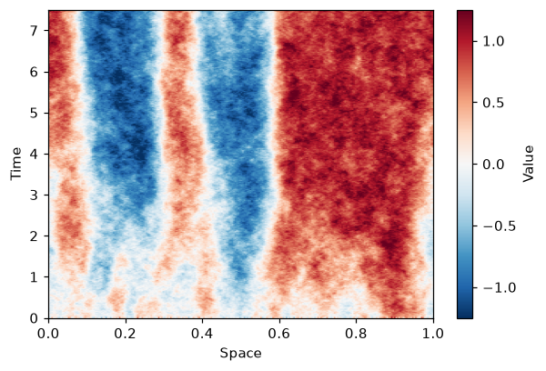
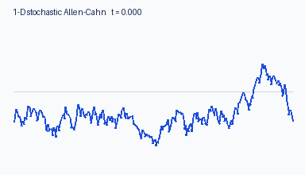
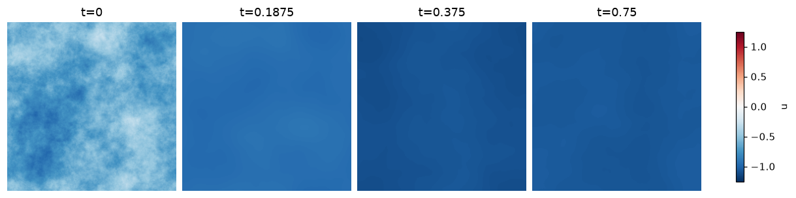
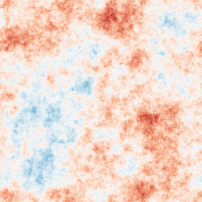

<p align="center">
  
</p>
<h4 align="center">Stochastic PDE solvers built on top of <a href="https://github.com/Ceyron/exponax" target="_blank">Exponax</a>.</h4>

<p align="center">
  <a href="#installation">Installation</a> •
  <a href="#quickstart">Quickstart</a> •
  <a href="#available-steppers">Available Steppers</a> •
  <a href="#utilities-for-spdes">Utilities for SPDEs</a> •
  <a href="#method">Method</a> •
  <a href="#validation">Validation</a> • <a href="#tests">Tests</a> • <a href="#extending-to-new-spdes">Extensions</a> • <a href="#known-limitations">Limitations</a> • <a href="#references">References</a> • <a href="#citation">Citation</a>
</p>

`exponax-spde` is a stochastic PDE add-on that installs with
[Exponax](https://github.com/Ceyron/exponax). Import deterministic solvers,
initial conditions, spectral utilities and visualisation from `exponax`.
It follows `exponax`'s design philosophy. Every stochastic stepper is a
differentiable [Equinox](https://github.com/patrick-kidger/equinox) Module,
JIT-compilable, vmappable, and GPU/TPU-ready, while adding the noise
infrastructure, ensemble utilities, and hybrid coupling tools that deterministic `exponax` does not need.

> **Note**: this package requires `exponax>=0.2.1,<0.3`.
> See the [0.3 migration guide](docs/migration-0.3.md) for import changes.
> It was developed following Felix Köhler's suggestion to build custom SPDE
> solvers *on top of* exponax rather than inside it.
> See the related [exponax PR #101](https://github.com/Ceyron/exponax/pull/101)
> for context.

---

## Installation

```bash
pip install exponax-spde
```

To install the latest main:

```bash
pip install "exponax-spde @ git+https://github.com/GVourvachakis/exponax-spde"
```

For development, use Poetry 2.4.2 with the committed dependency lock:

```bash
git clone https://github.com/GVourvachakis/exponax-spde.git
cd exponax-spde
poetry install -E dev -E test
```

Requires Python 3.10+, JAX 0.6.2+, and exponax >=0.2.1,<0.3.

👉 [JAX install guide](https://jax.readthedocs.io/en/latest/installation.html)

For 3-D volume rendering in the validation notebook (optional):

```bash
pip install "exponax[vape4d]"
```

---

## Quickstart

Simulate the **stochastic Allen-Cahn equation** in 1-D with additive
Q-Wiener noise — one stepper object, one line to roll out 500 steps
across 64 independent ensemble members:

```python
import jax
import exponax as ex
import exponax_spde as spde

# Build the stepper
stepper = spde.StochasticAllenCahn(
    num_spatial_dims=1,
    domain_extent=1.0,
    num_points=128,
    dt=5e-4,
    diffusivity=0.01,
    lambda_=1.0,
    sigma=0.1,
    noise_alpha=1.5,  # colour index: α=0 white noise, α>d/2 smooth
    noise_type="additive",
    use_taming=True,
)

# Initial condition
u0 = ex.ic.GaussianRandomField(1, powerlaw_exponent=3.0)(128, key=jax.random.PRNGKey(0))

# Single trajectory
num_steps, num_samples = 500, 64
trajectory = jax.jit(
    spde.stochastic_rollout(stepper, num_steps=num_steps, include_init=True)
)(u0, jax.random.PRNGKey(1))  # shape (501, 1, 128)

# Ensemble of 64 independent trajectories
ensemble = jax.jit(
    spde.stochastic_ensemble_rollout(
        stepper, num_steps=num_steps, num_samples=num_samples, include_init=False
    )
)(u0, jax.random.PRNGKey(2))  # shape (64, 500, 1, 128)

# Ensemble-averaged power spectrum S(k)
S_k = spde.structure_factor(ensemble, burn_in_fraction=0.5)
```

Because every stepper is a differentiable JAX function you can freely compose
it with `jax.grad`, `jax.vmap`, and `jax.jit`:

```python
# Gradient of final state w.r.t. initial condition
step_once = jax.jit(lambda field: stepper(field, key=jax.random.PRNGKey(0)))
grad_u0 = jax.grad(lambda field: step_once(field).sum())(u0)
```

<p align="center">
  
  &nbsp;
  
</p>

*Illustration, not validation evidence. 1-D stochastic Allen–Cahn driven by space-time white noise (α=0): a slightly biased disordered start orders into red and blue domains whose walls wander and merge (Funaki 1995). N=256, Δt=0.001, ν=0.0005, λ=1, σ=0.05, ETDRK1 without taming. Initial field 0.10 + 0.9·GRF (power 0.5, zero mean, key 10); rollout key 11; frames every 0.025 time units to t=7.5.*

<p align="center">
  
  &nbsp;
  
</p>

*Illustration, not validation evidence. Curvature-driven coarsening (Allen & Cahn 1979; Bray 1994): from a disordered start with a slight positive bias, blue islands shrink and the red phase grows from 75% to 85% of the domain. N=256 per axis, Δt=0.001, ν=0.0008, λ=10, σ=0.12, α=0.5, ETDRK1 with taming. Initial field 0.15 + 0.8·GRF (power 2.5, zero mean, key 20); rollout key 21; frames every 0.1 time units to t=10; snapshots at t=0, 0.5, 2.5 and 10.*

---

## Available Steppers

### Stochastic Allen-Cahn (`StochasticAllenCahn`)

Solves the $d$-dimensional ($d \in \{1, 2, 3\}$) stochastic Allen-Cahn SPDE
on a periodic domain in Itô form:

$$\partial_t u = \nu \Delta u + \lambda(u - u^3) + \sigma(u)\,\xi(x, t)$$

where $\xi$ is a Q-Wiener process with spectral covariance
$Q_k \propto (1 + |k|^2_{\rm phys})^{-\alpha}$.

| Parameter | Description | Default |
|-----------|-------------|---------|
| `diffusivity` | Interface width $\nu > 0$ | `0.01` |
| `lambda_` | Reaction rate $\lambda \geq 0$ | `1.0` |
| `sigma` | Physical Q-Wiener amplitude $\sigma \geq 0$ | `0.1` |
| `noise_alpha` | Spectral colour index $\alpha$ | `1.0` |
| `noise_type` | `"additive"` or `"multiplicative"` | `"additive"` |
| `use_taming` | Hutzenthaler-Jentzen taming of $-\lambda u^3$ | `True` |
| `use_milstein` | First-order Milstein correction (multiplicative, $\alpha>d/2$) | `False` |

**Special cases:**

- `lambda_=0` → stochastic heat equation (analytically tractable invariant measure)
- `sigma=0` and `use_taming=False` → matches `exponax.stepper.reaction.AllenCahn` at the same drift settings

**Calling convention** (PRNGKey required):

```python
u_next = stepper(u0, key=jax.random.PRNGKey(0))

# Batched over ensemble members:
keys = jax.random.split(jax.random.PRNGKey(0), num_samples)
u_batch = jax.vmap(lambda k: stepper(u0, key=k))(keys)
```

---

## Experimental increment API

Use `sample_increment(key)` to draw an additive convolution or a σ-free
multiplicative Wiener increment in raw rFFT units. Replay it with
`step_with_increment(u_hat, increment)`. Call
`fine.coarsen_increments(increments)` with two or more consecutive
increments along the leading axis to couple a longer step to a fine
path. To compile stepper methods, use `equinox.filter_jit` or JIT a closure
over the stepper.

The noise variance for a fixed `sigma` changes in v0.2.0.
See the [noise model and migration guide](docs/noise_model.md).

---

## Utilities for SPDEs

See the [performance and accelerator guide](docs/performance.md).

| Function | Description |
|----------|-------------|
| `stochastic_rollout(stepper, num_steps, *, include_init)` | Single trajectory via `jax.lax.scan`; JIT-compatible |
| `stochastic_ensemble_rollout(stepper, num_steps, num_samples, *, include_init)` | $M$ independent trajectories via `jax.vmap` |
| `structure_factor(ensemble, *, burn_in_fraction)` | Ensemble power spectrum $S(k) = \langle \vert \hat{u}_k \vert^2 \rangle$ |
| `stochastic_structure_factor(stepper, num_steps, num_samples, *, burn_in_fraction)` | Accumulates the same spectrum during rollout with no stored trajectories |
| `richardson_weak_extrapolation(stepper_coarse, stepper_fine, u0, num_steps_coarse, key, *, num_samples)` | Richardson extrapolation: $O(\Delta t) \to O(\Delta t^2)$ weak bias |
| `strang_split_step(spectral_stepper, ssa_step_fn, u, ssa_state, dt, key, *, ...)` | Second-order Strang splitting for hybrid PDE/SSA coupling |

---

## Method

`StochasticAllenCahn` uses the **Exponential Euler-Maruyama (EEM)** scheme
(Lord, Powell & Shardlow, 2014, Chapters 7–10).

The ETD operator splitting follows `exponax`'s `reaction.AllenCahn` convention
($L = \nu\Delta + \lambda$, $\mathcal{N} = -\lambda u^3$). Additive noise
uses the exact linear stochastic convolution. Multiplicative noise uses a
pointwise product of the step-start field with a plain Wiener increment,
then propagates the product. The optional Milstein term uses the same
propagation and requires trace-class noise ($\alpha>d/2$).

---

## Validation

The [validation notebook](validation/validate_stochastic_allen_cahn.ipynb)
compares the solvers with analytical predictions. Its text-only
[validation summary](docs/validation_summary.md) reports the measured
verdicts and uncertainty.

| Section | Experiment |
| --- | --- |
| 1 | Bit-exact deterministic parity with exponax ETDRK1 |
| 2–4 | Stationary and finite-time spectra, including a noise colour sweep |
| 5 | Conditional means and variances of additive and multiplicative kicks |
| 6–9 | Initial-condition sensitivity, matched-noise figures, radial PSD and 3-D midplanes |
| 10 | Fixed-grid additive strong order with coupled Brownian paths |
| 11 | Multiplicative benchmarks, including the supplemental N=32 comparison |
| Schemes | Deterministic orders 1–4, small-noise crossover, strong orders and taming |
| 12 | Weak Richardson bias with coupled and independent estimates and a Gaussian null |
| 13 | Host-side split-step scaffold with an exact OU source |
| 14 | Verification verdicts and statistical resolution |

Run the notebook with double precision enabled:

```bash
export JAX_ENABLE_X64=1
jupyter notebook validation/validate_stochastic_allen_cahn.ipynb
```

---

## Tests

```bash
# Fast tests only (~30 s on CPU)
JAX_ENABLE_X64=1 pytest tests/test_stochastic/ -m "not slow" -v

# Full suite including slow ensemble tests (~2 min on CPU)
JAX_ENABLE_X64=1 pytest tests/test_stochastic/ -v
```

The test suite covers: deterministic limit, 1-D/2-D invariant measures,
strong convergence order, structure-factor grid convergence, mean/variance
time series, Milstein conditional moments, and JAX compatibility.
The test extra includes physverify for host-side convergence checks.

---

## Extending to New SPDEs

The `stepper` subpackage provides the stochastic steppers.
To add a new SPDE stepper (e.g. stochastic Kuramoto-Sivashinsky):

1. Create `exponax_spde/stepper/_stochastic_ks.py`
2. Subclass `BaseStepper` from `exponax`
3. Implement `_build_linear_operator` and `_build_nonlinear_fun`
4. Use `TamedPolynomialNonlinearFun` if the nonlinearity grows super-linearly
5. Disable `step()`, require a PRNGKey in `__call__`
6. Add a `TestDeterministicLimit` class as a first sanity check
7. Export from `exponax_spde/stepper/__init__.py`

See `docs/extending.md` for a step-by-step template.

---

## Known Limitations

1. **Continuum regularity**: The stepper emits `NoiseRegularityWarning` at
   construction for additive or multiplicative noise when `num_spatial_dims >= 2`,
   the noise parameters are concrete, `sigma != 0`, `diffusivity > 0` and
   `noise_alpha <= num_spatial_dims / 2 - 1`. In this regime the additive
   continuum model requires renormalisation (Hairer, Ryser & Weber 2012), and
   the multiplicative continuum pointwise product is too rough. The stepper
   simulates a finite-grid model.
   [#8](https://github.com/GVourvachakis/exponax-spde/issues/8),
   [PR #25](https://github.com/GVourvachakis/exponax-spde/pull/25).
2. **Hybrid SSA**: the Python SSA callback limits JIT compilation across steps.

---

## References

- Funaki, T. (1995). *Probability Theory and Related Fields*, 102(2), 221–288. [DOI](https://doi.org/10.1007/BF01213390)
- Bray, A. J. (1994). *Advances in Physics*, 43(3), 357–459. [DOI](https://doi.org/10.1080/00018739400101505)
- Hairer, M., Ryser, M., & Weber, H. (2012). *Electronic Journal of Probability*, 17, 1–14. [DOI](https://doi.org/10.1214/EJP.v17-1731)
- Allen, S. M., & Cahn, J. W. (1979). *Acta Metallurgica*, 27(6), 1085–1095. [DOI](https://doi.org/10.1016/0001-6160(79)90196-2)
- Lord, G. J., Powell, C. E., & Shardlow, T. (2014). *An Introduction to Computational Stochastic PDEs*. Cambridge University Press. [DOI](https://doi.org/10.1017/CBO9781139017329)
- Jentzen, A., & Kloeden, P. E. (2009a). *Proceedings of the Royal Society A*, 465(2102), 649–667. [DOI](https://doi.org/10.1098/rspa.2008.0325)
- Hutzenthaler, M., & Jentzen, A. (2015). *Memoirs of the American Mathematical Society*, 236(1112). [DOI](https://doi.org/10.1090/memo/1112)
- Cox, S. M., & Matthews, P. C. (2002). *Journal of Computational Physics*, 176(2), 430–455. [DOI](https://doi.org/10.1006/jcph.2002.6995)
- Kassam, A.-K., & Trefethen, L. N. (2005). *SIAM Journal on Scientific Computing*, 26(4), 1214–1233. [DOI](https://doi.org/10.1137/S1064827502410633)
- Strang, G. (1968). *SIAM Journal on Numerical Analysis*, 5(3), 506–517. [DOI](https://doi.org/10.1137/0705041)
- Gillespie, D. T. (1977). *The Journal of Physical Chemistry*, 81(25), 2340–2361. [DOI](https://doi.org/10.1021/j100540a008)

---

## Citation

If you use this package in your research, please cite the upstream `exponax` paper
and this repository:

[Concept DOI, all versions](https://doi.org/10.5281/zenodo.24628654).

```bibtex
@inproceedings{koehler2024apebench,
  title={{APEBench}: A Benchmark for Autoregressive Neural Emulators of {PDEs}},
  author={Felix Koehler and Simon Niedermayr and R{\"u}diger Westermann and Nils Thuerey},
  booktitle={Advances in Neural Information Processing Systems},
  volume={37},
  year={2024},
  doi={10.52202/079017-3822}
}

@software{vourvachakis2026exponaxspde,
  author = {Vourvachakis, Georgios},
  title  = {exponax-spde: Stochastic PDE solvers built on top of exponax},
  year   = {2026},
  version = {0.2.0},
  doi = {10.5281/zenodo.24628654},
  url    = {https://github.com/GVourvachakis/exponax-spde},
}
```

## License

MIT — see [LICENSE.txt](LICENSE.txt).
